## Setup Guide

This guide gives reliable starting values and rules of thumb for clean, repeatable patterns.

### 1) Basic Setup (Turntable Rotation)

When **Turntable Rotation** is enabled:
- **Left Gear** should be a **prime number**.
- **Right Gear** should share a **greatest common divisor (GCD) > 4** with the **Turntable**.

Recommended starting values:
- **Left Gear:** 31
- **Right Gear:** 40
- **Turntable:** 60

### 2) Planetary Gear Setup

When **Planetary Gear** is enabled:
- The **Left Gear radius** is automatically set to **0**.
- This fixes the arm position on the left side.

Configuration rules:
- **Planetary Outer Gear** should be a **prime number**.
- **Right Gear** should again share a **GCD > 4** with the **Turntable**.

Recommended starting values:
- **Right Gear:** 40
- **Turntable:** 60
- **Planetary Outer Gear:** 29
- **Planetary Inner Gear:** 12

### 3) Arm Type and Control Points

You can switch **Arm Type** between:
- Simple
- Claw
- Super Claw

Then adjust the **Arm Control Points** to explore how the geometry changes the pattern.

### 4) Turntable Circular Movement

**Turntable Circular Movement** rotates the full turntable around a center point.  
With higher or less synchronized values for **Circular Move Teeth**, pattern complexity can increase significantly.

Recommended starting value:
- Set **Circular Move Teeth** equal to the **Turntable** teeth count.

### 5) Presets Overview

Most presets keep **Turntable = 60**, **Step Size = 0.005**, and **Speed = 1**.  
The most important differences are **Arm Type**, **Left/Right Gear teeth**, and whether **Planetary Gear** is enabled.

| Preset | Thumbnail | Most important parameters |
|---|---|---|
| 1. Planetary Star | 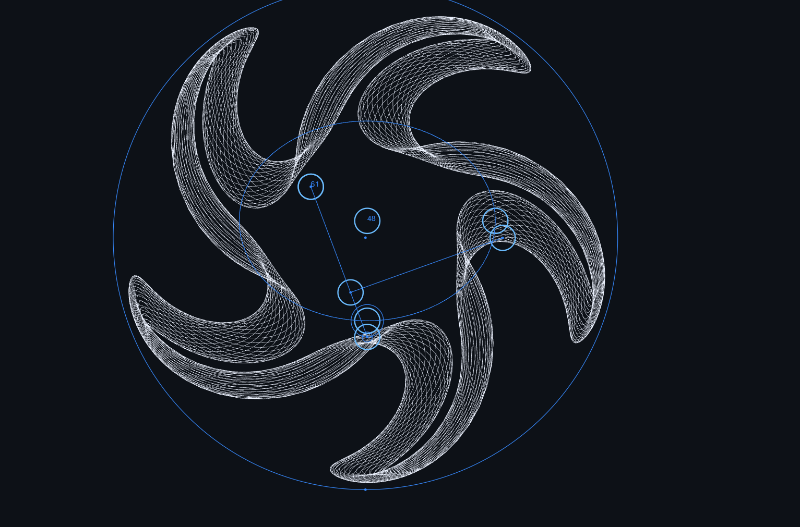 | Arm: Simple · Left/Right/Turntable: 61 / 48 / 60 · Planetary: On (Outer 29, Inner 12) |
| 2. Simple 5 | 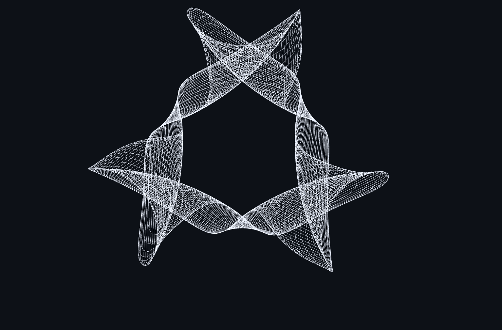 | Arm: Simple · Left/Right/Turntable: 61 / 40 / 60 · Planetary: Off |
| 3. Super Claw 3 | 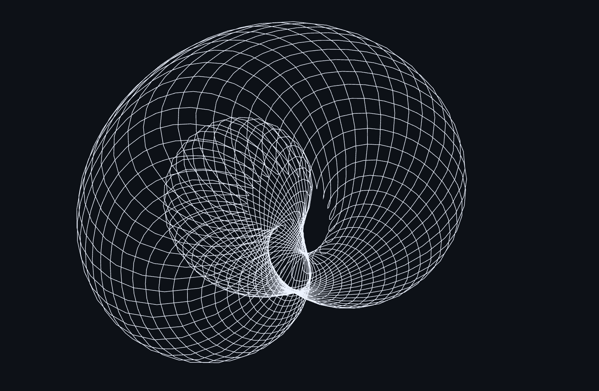 | Arm: SuperClaw · Left/Right/Turntable: 19 / 60 / 60 · Planetary: Off |
| 4. Planetary 3 | 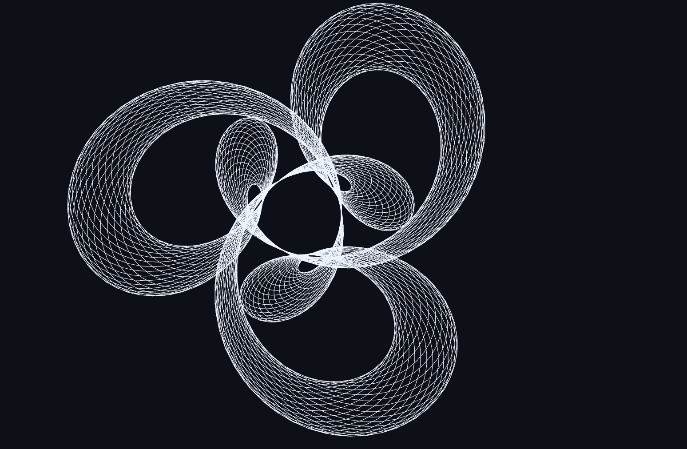 | Arm: Simple · Left/Right/Turntable: 29 / 40 / 60 · Planetary: On (Outer 29, Inner 12) |
| 5. Simple 3 | 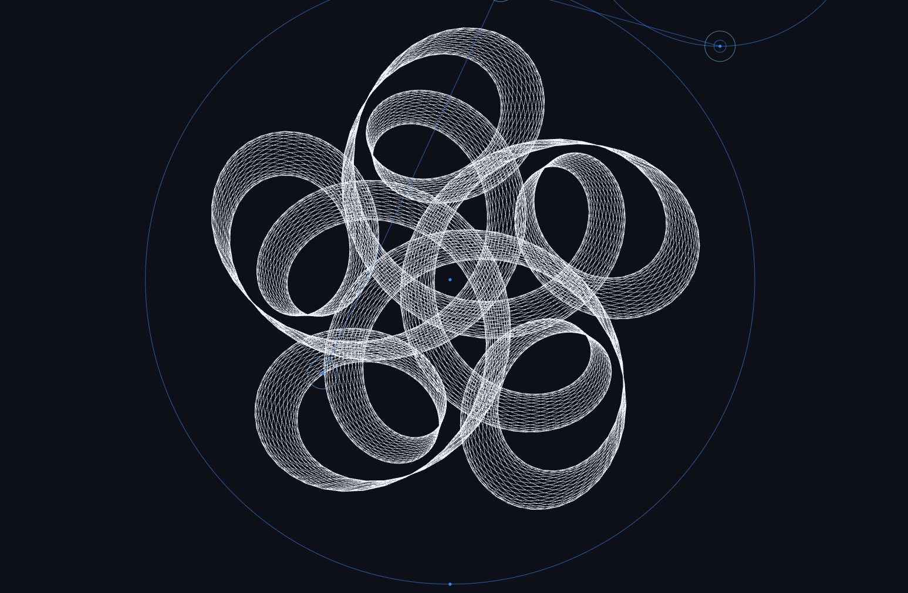 | Arm: Simple · Left/Right/Turntable: 31 / 48 / 60 · Planetary: Off |
| 6. Super Claw 1 | 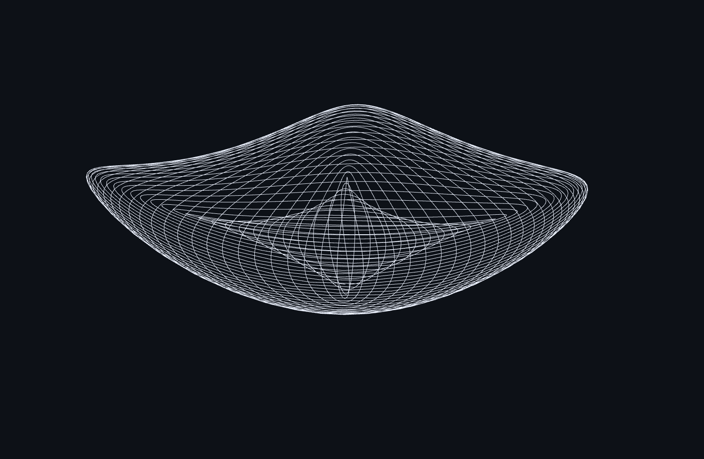 | Arm: SuperClaw · Left/Right/Turntable: 47 / 48 / 60 · Planetary: Off |
| 7. Claw 2 | 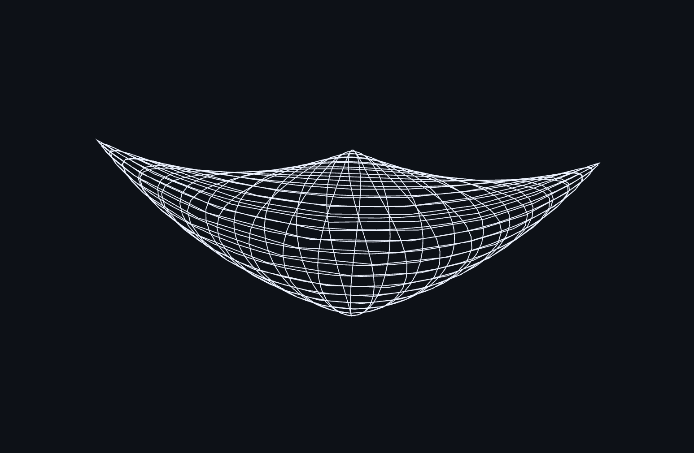 | Arm: Claw · Left/Right/Turntable: 23 / 24 / 60 · Planetary: Off |
| 8. Claw 1 | 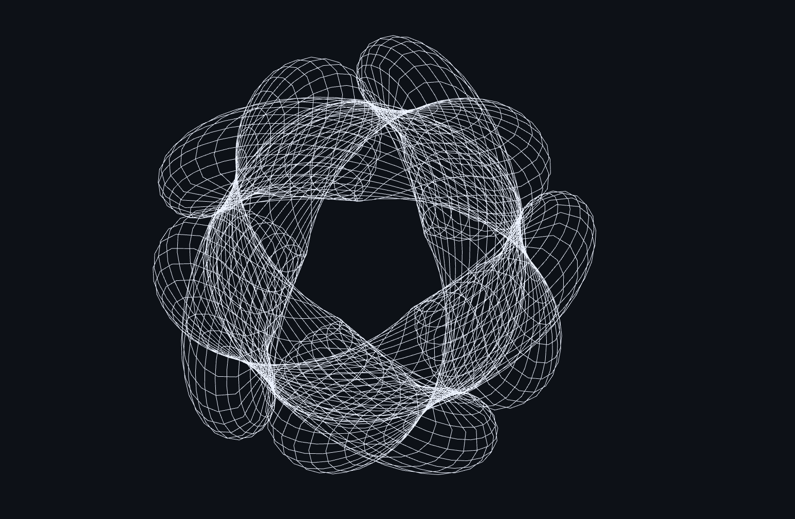 | Arm: Claw · Left/Right/Turntable: 23 / 24 / 60 · Planetary: Off |
| 9. Simple 3 | 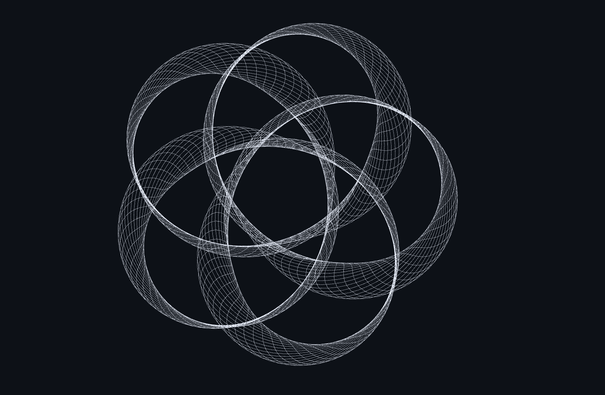 | Arm: Simple · Left/Right/Turntable: 19 / 48 / 60 · Planetary: Off |
| 10. Planetary Gear 2 | 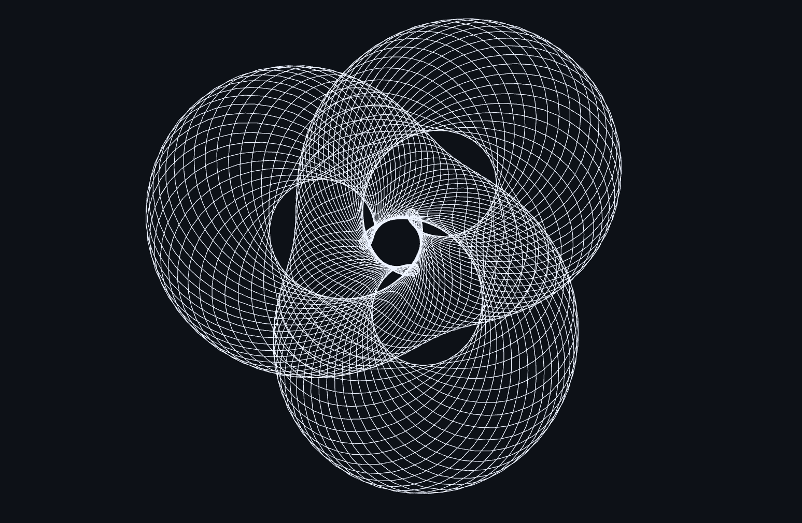 | Arm: Simple · Left/Right/Turntable: 31 / 40 / 60 · Planetary: On (Outer 29, Inner 12) |
| 11. Planetary Gear 1 | 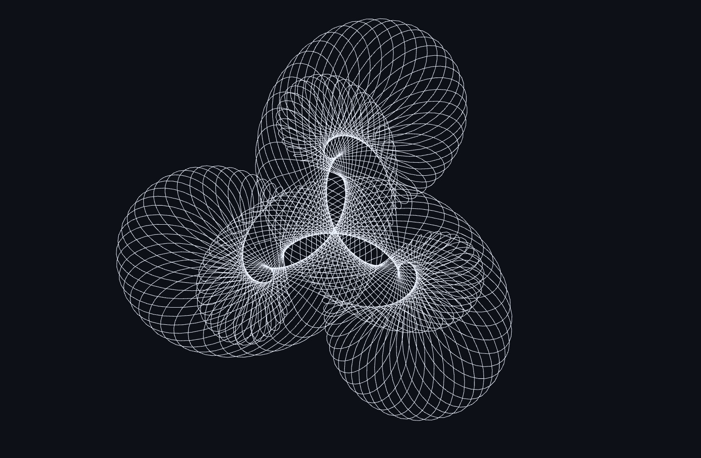 | Arm: Simple · Left/Right/Turntable: 31 / 40 / 60 · Planetary: On (Outer 29, Inner 12) |
| 12. Simple 1 | 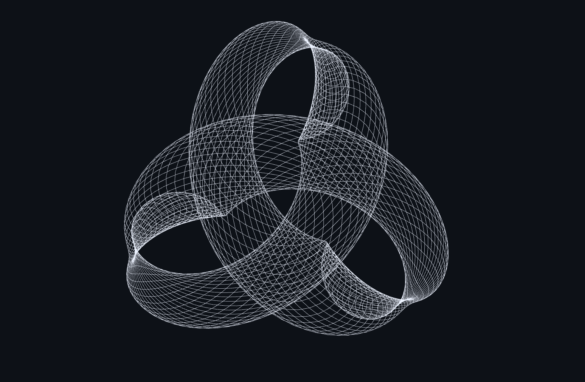 | Arm: Simple · Left/Right/Turntable: 31 / 40 / 60 · Planetary: Off |
| 13. Simple 2 | 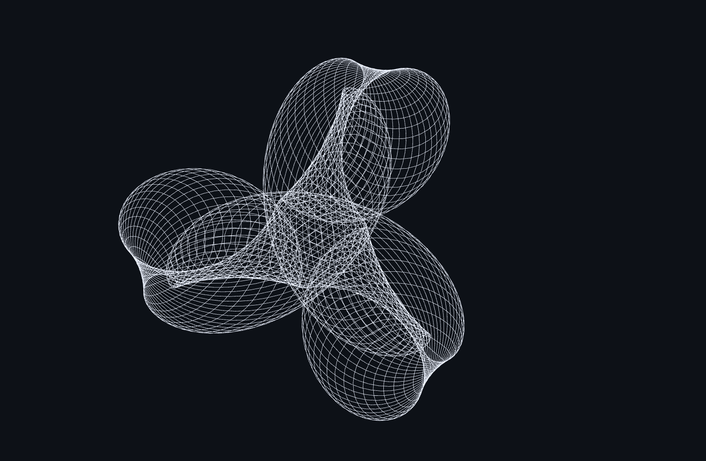 | Arm: Simple · Left/Right/Turntable: 31 / 40 / 60 · Planetary: Off |